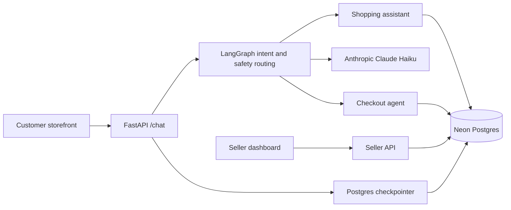
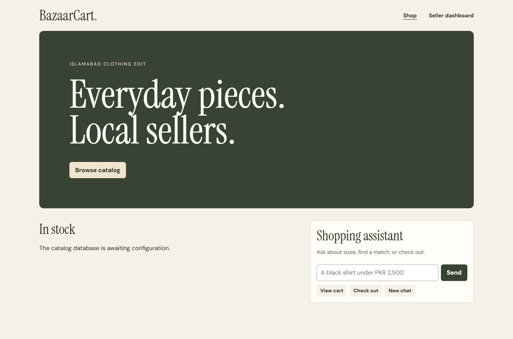
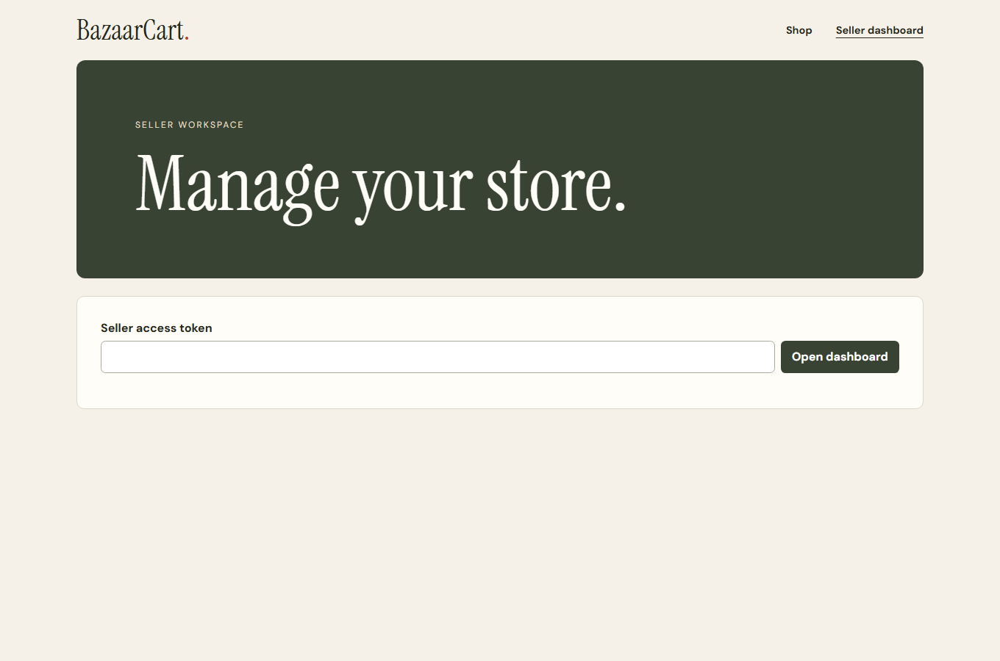

# BazaarCart

BazaarCart gives small clothing sellers in Islamabad a hosted catalog, a shopping assistant, and a dashboard for stock, orders, and sales. The proposed price is PKR 1,500 per seller per month. Checkout creates a demo order without payment processing.

**Track** ShopBot ? **Group** 13 ? **Course** AI-4016 Agentic AI, Section A

## Architecture



The shopping node searches live catalog stock and optionally suggests an add-on. The checkout node manages the cart, quotes the total, and checks for explicit confirmation. Confirming locks inventory rows, checks the quote and quantities again, and saves the order and stock changes in the same database transaction.

## Setup

Use Python 3.12 and install the backend from the repository root.

```powershell
python -m pip install -r requirements.txt
python -m uvicorn app.preview:app --host 127.0.0.1 --port 8765
```

Open `http://127.0.0.1:8765` for the local UI. To connect the real services and deploy the project, follow [the deployment guide](DEPLOY.md). The combined preview exposes the API under `/api`. The deployed backend serves it at the root.

| Public method | Body or response |
|---|---|
| `GET /health` | HTTP 200, plain text `ok` |
| `POST /chat` | Send `{"user_id":"...","thread_id":"...","message":"..."}`. Receive `reply`, `tool_calls`, and `tokens` with `in` and `out` counts. |

Seller endpoints require a bearer token scoped to the requested store. Import the [sample CSV](docs/catalog-example.csv) from the seller dashboard to demonstrate catalog management.

## Memory and isolation

| Scope | Storage and behavior |
|---|---|
| Conversation | LangGraph Postgres checkpointer scoped to the store, user, and thread. The graph keeps the latest filters, bounded product matches, cart, and pending checkout. It uses structured state for follow-ups, keeping the full raw chat out of the model context and checkpoint state. |
| Across conversations | PostgreSQL preferences scoped to the store and user. The agent saves explicitly requested size, budget, or style. A new thread starts with an empty cart and can recall the saved preferences. |
| Seller data | Every catalog and order query is scoped to the store. The seller must supply its private token to read dashboard data or import catalog rows. |
| Anonymous API | The grading endpoint accepts caller-supplied `user_id`. The browser generates a private random identifier. Anyone who learns an anonymous ID can reuse it, so this interface is suitable for demo shopping preferences. A commercial deployment handling customer data would need verified identity. |

Exact UI commands for viewing the cart, checking out, and confirming bypass the model. The remaining intent calls have bounded output and a database-backed daily call cap. The hash-scoped thread lock serializes concurrent updates to the same conversation.

## Screenshots

Captured from the running local UI before the cloud services were configured. The second image shows the seller access screen.





Demo GIF and video depend on the configured storefront and live checkout. See the deployment guide for the recording flow.

## Benchmark

| Check | Observed result |
|---|---|
| Local API and graph contract tests | 6/6 passed |
| Running local HTTP health endpoint | HTTP 200, body `ok` |
| JavaScript syntax | Passed |
| ShopBot live benchmark on Railway | 10/10 passed |
| Project-authored live safety cases on Railway | 5/5 passed |
| Model tokens across all 15 live cases | 3,695 input, 227 output |

Run the local tests with `python -m pytest -q` after installing pytest. Run the deployed benchmark with `python benchmark.py https://YOUR-API-HOST`. See [verification details](docs/VERIFICATION.md) and [the benchmark cases](tests.json).
